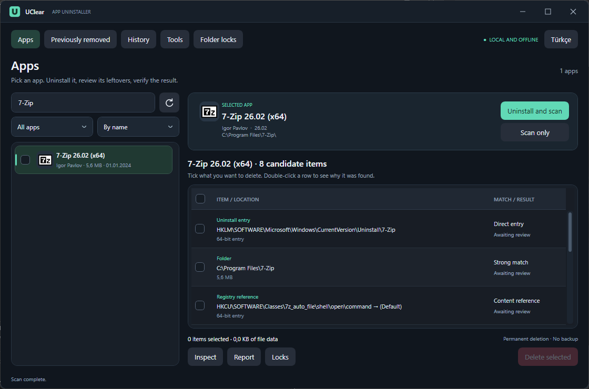
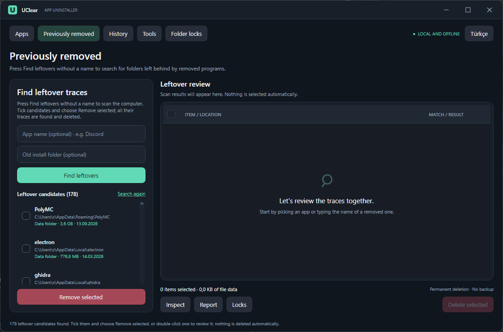
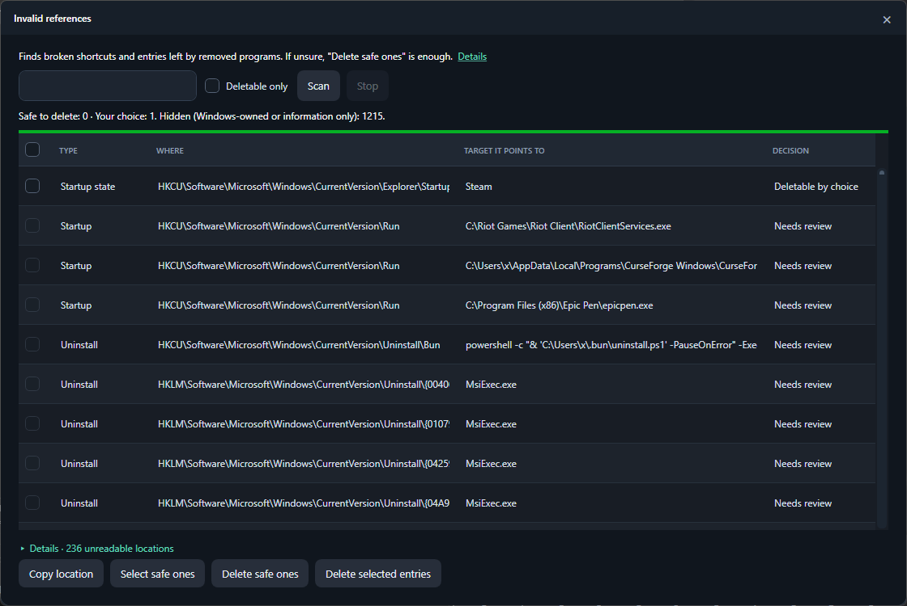
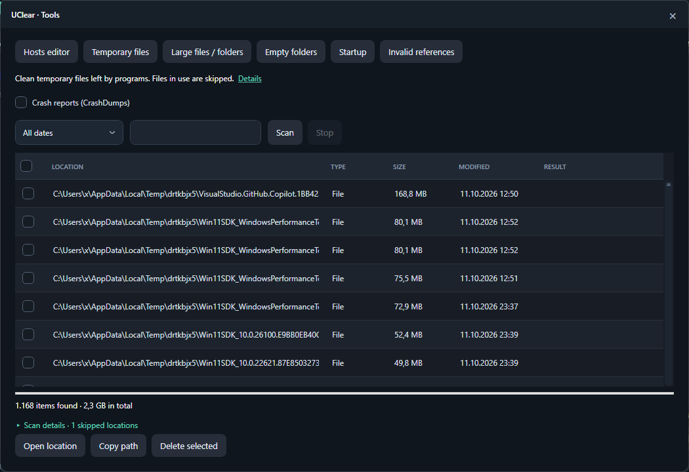

<p align="center"></p>

<h1 align="center">UClear</h1>

<p align="center"><b>A careful, offline uninstaller for Windows that finds what programs leave behind — without breaking Windows.</b></p>

<p align="center"><b>English</b> · <a href="README.tr.md">Türkçe</a></p>

---

UClear removes programs the way you expect: it runs the program's own uninstaller, then finds the folders, Registry keys and other traces the uninstaller left behind and lets you delete them. It also finds leftovers of programs you removed long ago, broken shortcuts and startup entries, and offers a few disk tools.

It is **not** a "PC booster" or Registry cleaner. It has no telemetry, no ads and no online component. Every deletion is checked again right before it happens, and anything that belongs to Windows is never offered for deletion.

<p align="center"></p>

## Screenshots

| Previously removed programs | Invalid references |
|---|---|
|  |  |
| **Temporary files** | |
|  | |

## Highlights

- **Uninstall + leftover cleanup** – runs the uninstaller, then scans folders, Registry keys and Registry values that still point to the program.
- **Bulk uninstall** – tick several apps and confirm once. Programs that support it are removed silently; leftovers of all of them are found in one shared scan.
- **Microsoft Store apps** – listed and removed with Windows' own `Remove-AppxPackage`. Windows-owned packages are hidden and cannot be removed.
- **Force uninstall** – for programs whose uninstaller is broken or missing.
- **Previously removed programs** – one click finds folders that no installed program, service, startup entry, running process or driver vendor accounts for.
- **Invalid references** – broken shortcuts, startup entries, app paths, COM/command entries, orphaned services and scheduled tasks, sorted into *safe to delete*, *your choice* and *review only*.
- **Tools** – temporary files, large files/folders, empty folders, startup manager, hosts editor, and a folder-lock inspector that shows which process holds a file.
- **Fast and live** – results appear while scanning; the Registry is walked in parallel and shared across programs.
- **English and Turkish** – the whole interface; switch any time from the top bar.

## Safety

UClear's first rule is: **never break Windows.**

- Items that belong to Windows or Microsoft are never deleted. This covers:
  - the Windows folder and Microsoft folders under Program Files, ProgramData and AppData,
  - WindowsApps, system Store packages, language packs and codecs,
  - drivers, `\Microsoft\` scheduled tasks and the recovery/boot folders.
- Folders shared with another installed program or publisher are kept.
- Name matches alone are never trusted. Uncertain items are shown but cannot be selected.
- Links (junctions/symlinks) are never followed. Cloud-only OneDrive files are never opened.
- In the Registry only the exact broken value or the program's own key is removed; parent keys and other values stay.
- Every item is verified again just before deletion: the target is still missing, the value has not changed, and the program is not running.
- Deletion is **permanent** and there is **no backup**. Read the confirmation list before you continue.

## Download

1. Download `UClear.exe` from the [latest release](../../releases/latest).
2. Optional: compare its SHA-256 with the value published in the release.
3. Run it. UClear asks for administrator rights because uninstalling and cleaning machine-wide locations require them.

It is a single, portable executable for **Windows 10/11 x64**. No .NET installation is needed.

> The executable is not code-signed, so Windows SmartScreen may warn you the first time. Choose **More info → Run anyway**, or build it yourself from source.

## Using UClear

| Page | What it does |
|---|---|
| **Apps** | Search, filter (desktop / Store / last 30 days / over 1 GB) and sort the installed apps. **Uninstall and scan** runs the uninstaller and then shows the leftovers. Tick several apps for **Uninstall selected**. Right-click an app to force uninstall it, open its folder, open its Registry entry, search the web or copy its name or uninstall command. |
| **Previously removed** | Press **Find leftovers** without a name to search the whole computer, or type a program name and optionally its old folder. Tick candidates and choose **Remove selected**: all their traces are found and the safe ones deleted in one go. |
| **History** | Every scan, deletion and verification result is logged locally. |
| **Tools** | Temporary files, large files/folders, empty folders, startup manager, invalid references and the hosts editor. |
| **Folder locks** | Pick a folder or drop it onto the window to see which processes use its files and what blocks its deletion. |

Leftover candidates are labelled:

- **Program folder:** the program's install folder was left behind.
- **Data folder:** the program's settings or cache folder was left behind. It may contain game saves.
- **Recently used:** the folder changed in the last 3 days, so it may still be in use.
- **Unregistered program:** the folder still holds a working program. It is not a leftover and cannot be bulk-removed.

## Data and privacy

UClear works fully offline. The only exception is **Search the web** in the right-click menu, which opens your browser. It writes three small files to `%LOCALAPPDATA%\UClear\`:

- `history.jsonl` – the activity log shown on the History page; it can be cleared there.
- `settings.json` – the selected interface language.
- `errors.log` – details of unexpected errors, if any happen.

## Language

On first start UClear uses Turkish on Turkish Windows and English everywhere else. Use the language button in the top bar to switch; the choice is remembered.

## Building from source

Requires Windows and the [.NET 10 SDK](https://dotnet.microsoft.com/download). There are no external NuGet dependencies.

```powershell
dotnet build src/UClear -c Release
dotnet run --project tests/UClear.Tests.csproj -c Release
dotnet publish src/UClear/UClear.csproj -c Release -r win-x64 --self-contained true -p:PublishSingleFile=true -p:IncludeNativeLibrariesForSelfExtract=true -p:EnableCompressionInSingleFile=true -p:DebugType=None -o dist/win-x64
```

`scripts/Publish.ps1` does the same publish. It also closes a running copy of `dist/win-x64/UClear.exe` first and writes the SHA-256 to `dist/win-x64/SHA256.txt`.

The tests only touch the scratch folders and unique `HKCU` test keys they create. They never uninstall real programs or change the real hosts file or startup entries.

## Limitations

- UClear does not claim to find every trace. Indirect GUID chains, products renamed after install, other user profiles and custom disk locations are not covered.
- There is no install monitoring (snapshot before/after setup).
- Store apps are listed for the current user only.
- Drivers are never removed. Services and scheduled tasks are removed only under strict conditions in **Invalid references**.
- The executable is not code-signed.

## License

[MIT](LICENSE) – free to use, modify and share.
