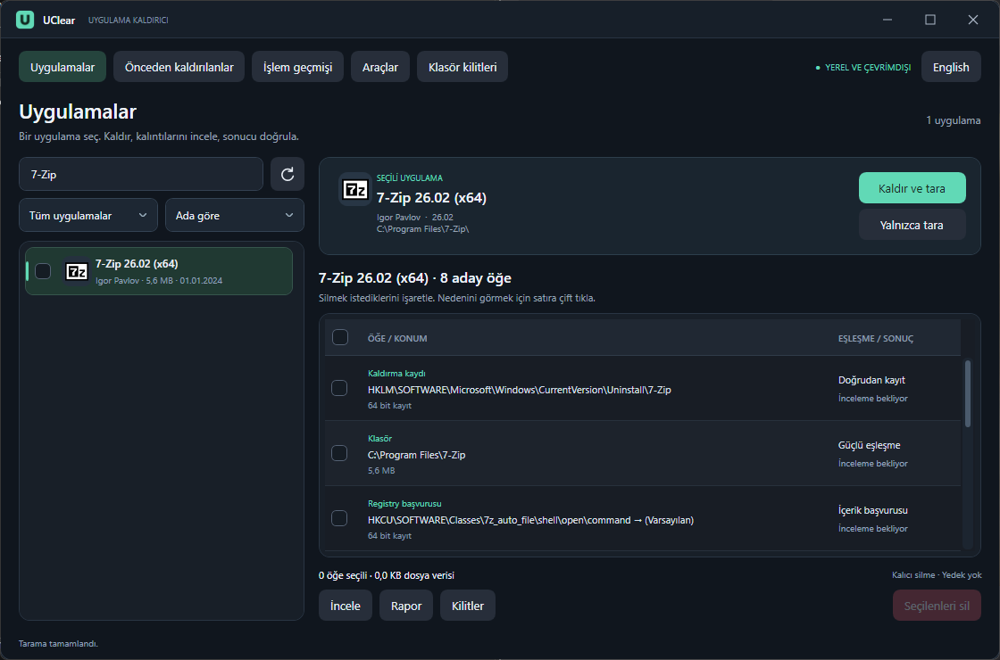
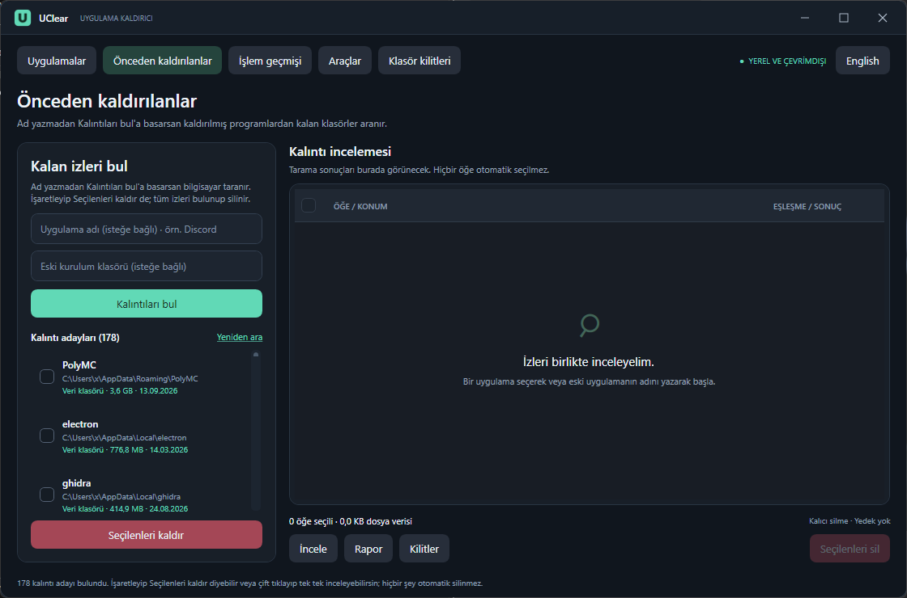
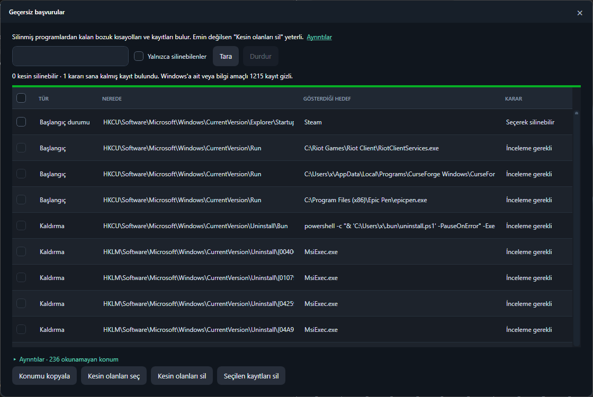
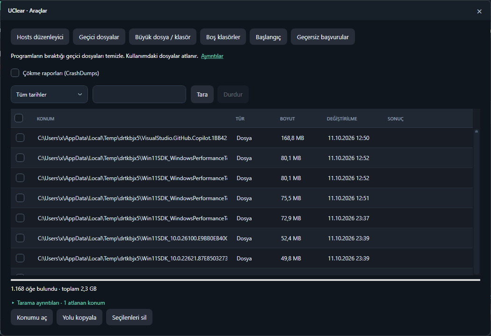

<p align="center"></p>

<h1 align="center">UClear</h1>

<p align="center"><b>Programların geride bıraktıklarını bulan, Windows'u bozmayan, dikkatli ve çevrimdışı bir Windows kaldırıcı.</b></p>

<p align="center"><a href="README.md">English</a> · <b>Türkçe</b></p>

---

UClear programları beklediğin gibi kaldırır: önce programın kendi kaldırıcısını çalıştırır, sonra kaldırıcının geride bıraktığı klasörleri, Registry anahtarlarını ve diğer izleri bulur ve silmene izin verir. Uzun zaman önce kaldırdığın programların kalıntılarını, bozuk kısayolları ve başlangıç kayıtlarını da bulur. Birkaç disk aracı da içerir.

"PC hızlandırıcı" veya Registry temizleyici **değildir**. Telemetri, reklam ve çevrimiçi bileşen içermez. Her silme işleminden hemen önce öğe yeniden doğrulanır ve Windows'a ait hiçbir şey silinmek üzere önerilmez.

<p align="center"></p>

## Ekran görüntüleri

| Önceden kaldırılanlar | Geçersiz başvurular |
|---|---|
|  |  |
| **Geçici dosyalar** | |
|  | |

## Öne çıkanlar

- **Kaldırma + kalıntı temizliği:** Kaldırıcıyı çalıştırır, ardından programa hâlâ işaret eden klasörleri, Registry anahtarlarını ve değerlerini tarar.
- **Toplu kaldırma:** Birden çok uygulamayı işaretle, bir kez onayla. Destekleyen programlar pencere açmadan kaldırılır; hepsinin kalıntıları tek ortak taramayla bulunur.
- **Microsoft Store uygulamaları:** Windows'un kendi `Remove-AppxPackage` komutuyla listelenir ve kaldırılır. Windows'a ait paketler gizlenir ve kaldırılamaz.
- **Zorla kaldır:** Kaldırıcısı bozuk veya eksik programlar için.
- **Önceden kaldırılanlar:** Tek tıkla, hiçbir yüklü programa, servise, başlangıç kaydına, çalışan sürece veya sürücü üreticisine ait olmayan klasörleri bulur.
- **Geçersiz başvurular:** Bozuk kısayollar, başlangıç kayıtları, uygulama yolları, COM/komut kayıtları, sahipsiz servis ve zamanlanmış görevler. Hepsi *kesin silinebilir*, *karar senin* ve *yalnızca inceleme* olarak ayrılır.
- **Araçlar:** Geçici dosyalar, büyük dosya/klasörler, boş klasörler, başlangıç yöneticisi, hosts düzenleyici ve bir dosyayı hangi programın tuttuğunu gösteren klasör kilidi incelemesi.
- **Hızlı ve canlı:** Sonuçlar tarama sürerken gelir. Registry paralel taranır ve birden çok program için tek turda dolaşılır.
- **Türkçe ve İngilizce:** Arayüzün tamamı iki dilli; üst çubuktan istediğin zaman değiştirebilirsin.

## Güvenlik

UClear'ın ilk kuralı: **Windows'u asla bozmamak.**

- Windows'a veya Microsoft'a ait öğeler asla silinmez. Bunlar:
  - Windows klasörü ile Program Files, ProgramData ve AppData altındaki Microsoft klasörleri,
  - WindowsApps, sistem Store paketleri, dil paketleri ve codec'ler,
  - sürücüler, `\Microsoft\` zamanlanmış görevleri ve kurtarma/önyükleme klasörleri.
- Başka bir yüklü program veya yayıncıyla ortak olan klasörler korunur.
- Tek başına ad eşleşmesine güvenilmez. Belirsiz öğeler gösterilir ama seçilemez.
- Bağlantılar (junction/symlink) asla takip edilmez. Yalnızca bulutta duran OneDrive dosyaları açılmaz.
- Registry'de yalnızca tam olarak bozuk olan değer veya programın kendi anahtarı silinir; üst anahtarlar ve diğer değerler kalır.
- Her öğe silmeden hemen önce yeniden doğrulanır: hedef hâlâ eksik mi, değer değişmiş mi, program çalışıyor mu.
- Silme **kalıcıdır** ve **yedek alınmaz**. Devam etmeden önce onay listesini oku.

## İndirme

1. `UClear.exe` dosyasını [son sürümden](../../releases/latest) indir.
2. İstersen SHA-256 değerini sürüm notlarındaki değerle karşılaştır.
3. Çalıştır. Kaldırma ve bilgisayar genelindeki konumları temizleme yönetici yetkisi gerektirdiği için UClear yönetici izni ister.

**Windows 10/11 x64** için tek dosyalık, taşınabilir bir programdır. .NET kurulumu gerekmez.

> EXE dijital olarak imzalı değildir; Windows SmartScreen ilk açılışta uyarı verebilir. **Ek bilgi → Yine de çalıştır** seçeneğini kullan veya kaynak koddan kendin derle.

## Kullanım

| Sayfa | Ne yapar |
|---|---|
| **Uygulamalar** | Yüklü uygulamalarda ara, filtrele (masaüstü / Store / son 30 gün / 1 GB üstü) ve sırala. **Kaldır ve tara** kaldırıcıyı çalıştırır, ardından kalıntıları gösterir. Birden çok uygulamayı işaretleyip **Seçilenleri kaldır** de. Sağ tıkla zorla kaldır, klasörünü aç, Registry kaydını aç, internette ara, adını veya kaldırma komutunu kopyala. |
| **Önceden kaldırılanlar** | Ad yazmadan **Kalıntıları bul**'a basarsan tüm bilgisayar taranır; istersen program adını ve eski klasörünü yaz. Adayları işaretleyip **Seçilenleri kaldır** de; tüm izleri bulunur ve güvenli olanlar tek seferde silinir. |
| **İşlem geçmişi** | Her tarama, silme ve doğrulama sonucu bilgisayarda kayıt altına alınır. |
| **Araçlar** | Geçici dosyalar, büyük dosya/klasörler, boş klasörler, başlangıç yöneticisi, geçersiz başvurular ve hosts düzenleyici. |
| **Klasör kilitleri** | Bir klasör seç veya pencereye sürükle; dosyalarını hangi süreçlerin kullandığını ve silinmesini neyin engellediğini gösterir. |

Kalıntı adaylarının etiketleri:

- **Program klasörü:** Programın kurulum klasörü kalmış.
- **Veri klasörü:** Programın ayar veya önbellek klasörü kalmış. Oyun kayıtları içerebilir.
- **Yeni kullanılmış:** Son 3 günde değişmiş, hâlâ kullanılıyor olabilir.
- **Kayıtsız program:** Klasörde çalışır bir program duruyor. Kalıntı değildir ve toplu kaldırılamaz.

## Veri ve gizlilik

UClear tamamen çevrimdışı çalışır. Tek istisna sağ tık menüsündeki **İnternette ara**; bu seçenek tarayıcını açar. `%LOCALAPPDATA%\UClear\` içine üç küçük dosya yazar:

- `history.jsonl`: İşlem geçmişi sayfasında görünen kayıtlar; oradan temizlenebilir.
- `settings.json`: Seçilen arayüz dili.
- `errors.log`: Beklenmeyen bir hata olursa ayrıntıları.

## Dil

İlk açılışta Türkçe Windows'ta Türkçe, diğer tüm dillerde İngilizce kullanılır. Üst çubuktaki dil düğmesiyle değiştirebilirsin; seçim hatırlanır.

## Kaynak koddan derleme

Windows ve [.NET 10 SDK](https://dotnet.microsoft.com/download) gerekir. Harici NuGet bağımlılığı yoktur.

```powershell
dotnet build src/UClear -c Release
dotnet run --project tests/UClear.Tests.csproj -c Release
dotnet publish src/UClear/UClear.csproj -c Release -r win-x64 --self-contained true -p:PublishSingleFile=true -p:IncludeNativeLibrariesForSelfExtract=true -p:EnableCompressionInSingleFile=true -p:DebugType=None -o dist/win-x64
```

`scripts/Publish.ps1` aynı yayımlamayı yapar. Ayrıca önce `dist/win-x64/UClear.exe` çalışıyorsa onu kapatır ve SHA-256 değerini `dist/win-x64/SHA256.txt` dosyasına yazar.

Testler yalnızca kendi oluşturdukları deneme klasörlerine ve benzersiz `HKCU` deneme anahtarlarına dokunur. Gerçek programları kaldırmaz, gerçek hosts dosyasını veya başlangıç kayıtlarını değiştirmez.

## Sınırlar

- UClear her izi bulduğunu iddia etmez. Dolaylı GUID zincirleri, kurulumdan sonra adı değişen ürünler, diğer kullanıcı profilleri ve özel disk konumları kapsanmaz.
- Kurulum izleme (kurulum öncesi/sonrası karşılaştırma) yoktur.
- Store uygulamaları yalnızca geçerli kullanıcı için listelenir.
- Sürücüler asla kaldırılmaz. Servisler ve zamanlanmış görevler yalnızca **Geçersiz başvurular** içinde sıkı koşullarla silinir.
- EXE dijital olarak imzalı değildir.

## Lisans

[MIT](LICENSE): Ücretsiz kullanabilir, değiştirebilir ve paylaşabilirsin.
